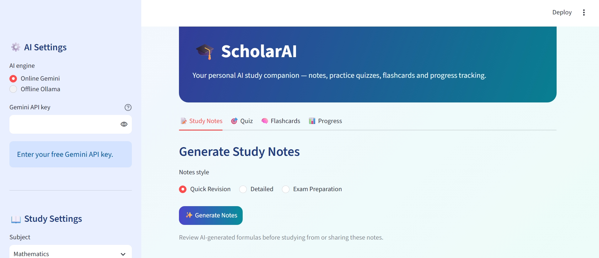
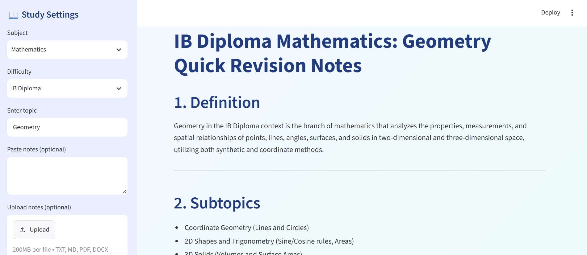
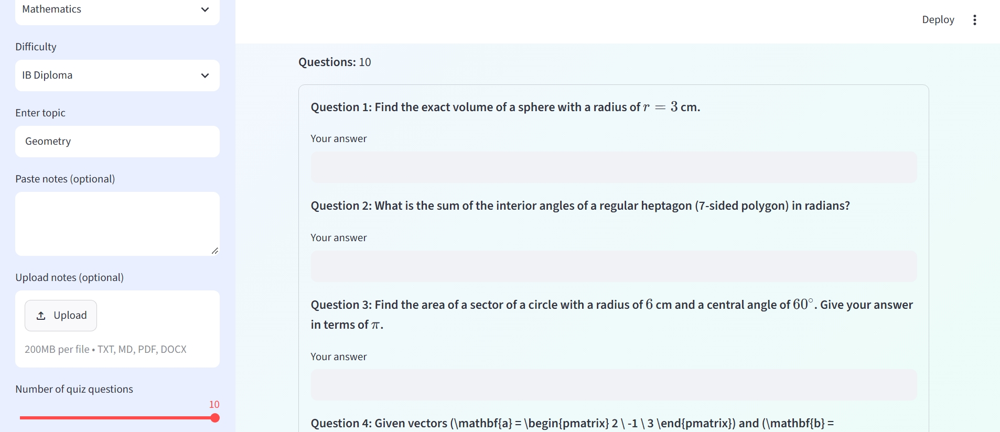
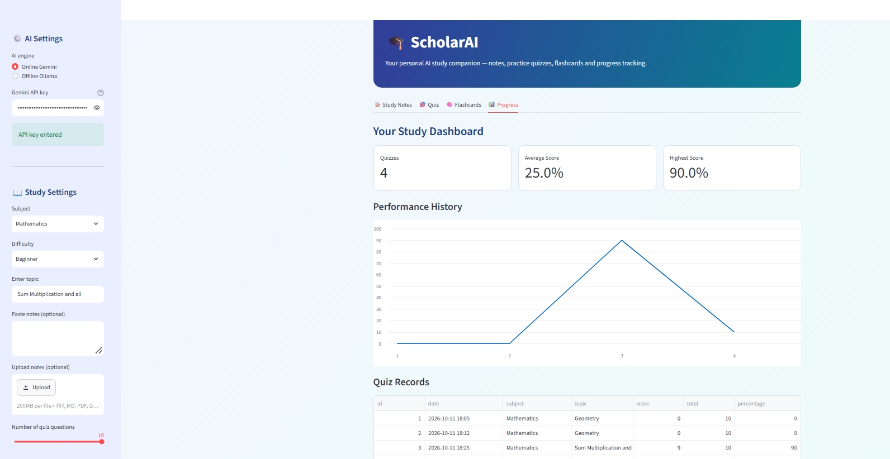

# 🎓 ScholarAI: AI-Powered Study Assistant

ScholarAI is a Python-based educational application designed to help students study more efficiently through AI-generated notes, practice quizzes, flashcards, and progress tracking.

I built ScholarAI as a personal Computer Science project to combine AI-generated notes, practice quizzes, flashcards, and progress tracking in one Python app. The goal was to build something useful while learning about Streamlit, AI models, and local data storage.

## Watch the Demo

[▶ Watch the real ScholarAI demo (1 minute 27 seconds)](ScholarAI_Real_App_Demo.mp4)

[](ScholarAI_Real_App_Demo.mp4)

This short video shows me actually using ScholarAI: generating notes, completing a quiz, reviewing flashcards, and opening the progress dashboard. I removed longer waiting periods to keep the demonstration concise.

## Features

- **AI Study Notes:** Generate revision notes and explanations for different subjects and topics.
- **AI Quiz Generator:** Create personalized questions with automatic answer checking.
- **Interactive Flashcards:** Revise important concepts and download flashcards.
- **Study Progress Dashboard:** Track quiz scores and performance over time.
- **Document Support:** Upload TXT, Markdown, PDF, and DOCX study material.
- **PDF Export:** Download generated notes for offline revision.
- **Dual AI Support:** Use Google Gemini online or Ollama locally.

## Project Screenshots

### Main interface


### Generated notes


### Practice quiz


### Progress dashboard


## Technologies Used

- Python
- Streamlit
- Google Gemini API
- Ollama (Llama 3.2)
- SQLite
- Pandas
- ReportLab
- pypdf
- python-docx

## How It Works

Students choose a subject, enter a topic or upload study material, and use the AI features to generate educational content. Quiz results are stored locally using SQLite and displayed through a progress dashboard.

## Running the Application

Install the dependencies:

```bash
py -m pip install -r requirements.txt
```

Start ScholarAI:

```bash
py -m streamlit run app.py
```

For online AI, obtain a Gemini API key from Google AI Studio and enter it in the application's sidebar.

For offline AI, install Ollama and download the `llama3.2:3b` model.

## Limitations and Future Improvements

AI-generated educational content may contain inaccuracies. Quiz grading may not recognize all mathematically equivalent answers. Online AI requires internet access and is subject to API limits, while offline AI performance depends on the computer's hardware.

## Project Status

Working educational prototype, developed as an independent Python and AI portfolio project.
